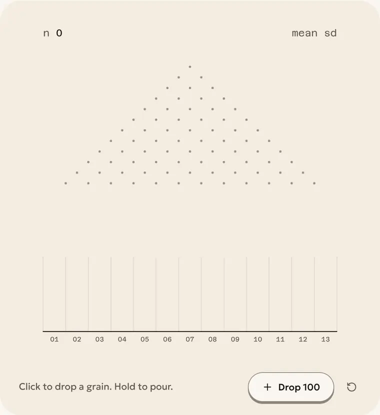
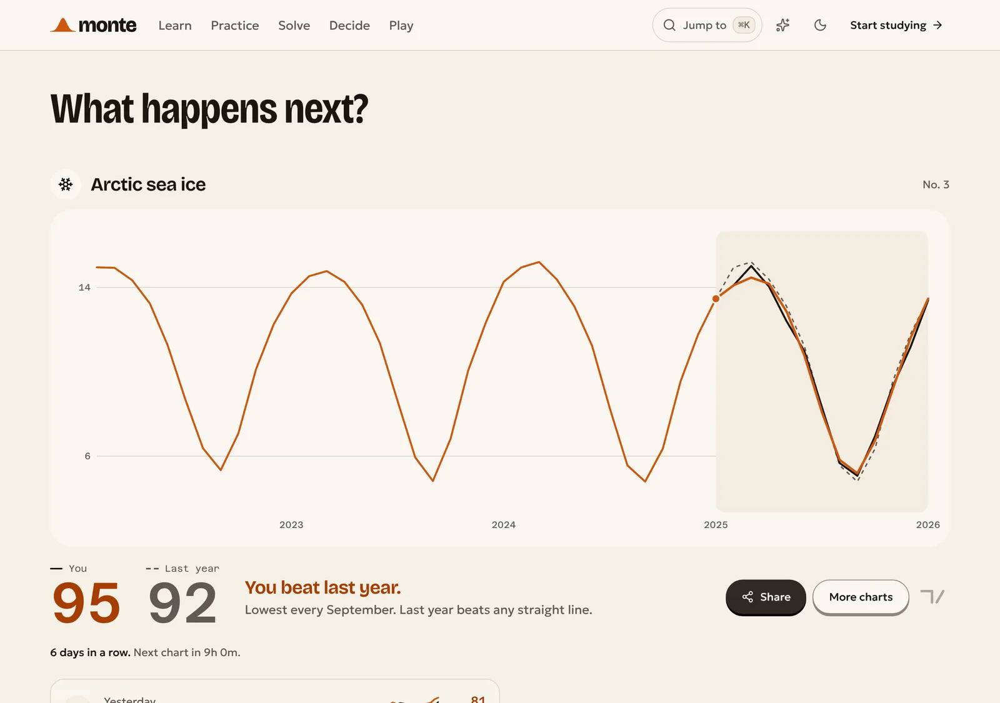
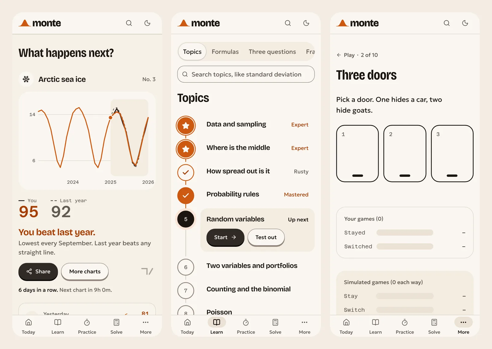

<h1 align="center">
  <a href="https://monte.markets">
    <picture>
      <source media="(prefers-color-scheme: dark)" srcset="public/brand/monte-logo-dark.svg">
      
    </picture>
  </a>
</h1>

<p align="center">
  <a href="https://monte.markets"></a>
</p>

<p align="center"><b>Statistics, one idea at a time. Free, no sign-up.</b></p>

<p align="center">
  <a href="https://github.com/skirberg/monte/actions/workflows/ci.yml"></a>
  <a href="https://scorecard.dev/viewer/?uri=github.com/skirberg/monte"></a>
  <a href="LICENSE"></a>
  <a href="LICENSE-CONTENT"></a>
  <a href="#use-it-from-a-chat-app"></a>
  <a href="https://monte.markets"></a>
</p>

<p align="center">
  <a href="https://monte.markets/shuffle/"><b>Today&rsquo;s Shuffle</b></a> ·
  <a href="https://monte.markets/daily/"><b>Today&rsquo;s chart</b></a> ·
  <a href="https://monte.markets/learn/">Learn</a> ·
  <a href="https://monte.markets/play/">Games</a> ·
  <a href="#use-it-from-a-chat-app">Use it from a chat app</a> ·
  <a href="https://monte.markets/brand/">Brand</a>
</p>

Tap the board and a grain drops. Hold and it pours. Each grain bounces left or right twelve times, and the pile settles under the curve. The rest of Monte is built the same way: you do something, then the idea shows up.

## Today&rsquo;s Shuffle

Three-card monte with a statistics question, one round a day, the same for everyone. Three answers sit on the table under three cups: one is right, and the other two are the answers the story leads people to (one bottle's spread for an average, the question turned around, chances added). The cups come down and are thrown. Follow the right one, lift a cup, and see the work, drawn: the curves and the tail, a thousand dots, a line for every pair (`components/play/shuffle-work.tsx`). Share how many lifts it took, without spoilers, and keep your run of days going. Every answer is computed by the lessons' and solvers' own code.

## Today&rsquo;s chart

One real chart a day, the same for everyone: Arctic sea ice, CO₂ at Mauna Loa, fireworks complaints in New York, potholes in Chicago. The end is hidden. Draw what you think happens, then see the real line and how a plain rule ("same as last year") did. Share your score, keep your run of days going, and see yesterday&rsquo;s answer.

[](https://monte.markets/daily/)

## What&rsquo;s inside

[](https://monte.markets)

- **Learn.** Fourteen topics from data and sampling to multiple regression, 70 small lessons that each open with a question. Find your level in eight questions, test out of what you know, and go Expert on what you have mastered.
- **Practice.** Drills with fresh numbers every time, mock tests, flashcards, and a review that keeps mastered topics from going rusty.
- **Solve.** Eleven solvers that show every step, from Bayes trees to confidence intervals.
- **Decide.** Nine calculators for real choices in plain English: a test result, a warranty, an A/B test, a savings goal.
- **Play.** Ten games that each hide one idea: three doors, election night, the long run of the market.

Progress stays in your browser. No account, no ads, no paywall.

## Use it from a chat app

Monte&rsquo;s solvers and lessons are also a remote MCP server: `https://mcp.monte.markets/mcp` (read-only, no key). It is listed on the official MCP Registry as `io.github.skirberg/monte`.

- **Claude:** Settings, Connectors, Add custom connector, then paste the URL.
- **Claude Code:** `claude mcp add --transport http monte https://mcp.monte.markets/mcp`
- **Any MCP client:** add a Streamable HTTP server with the URL above.

Eight tools: the topics, the glossary, the eleven solvers, and three decisions (test result, warranty, A/B test). See [`mcp/README.md`](mcp/README.md).

Every content page is also plain Markdown at its path without the trailing slash, plus `.md`: [`/learn/normal.md`](https://monte.markets/learn/normal.md), [`/decide/warranty.md`](https://monte.markets/decide/warranty.md), [`/index.md`](https://monte.markets/index.md). [`/llms.txt`](https://monte.markets/llms.txt) lists them all, [`/llms-full.txt`](https://monte.markets/llms-full.txt) holds the whole course in one file, and [`/api/v1/`](https://monte.markets/api/v1/index.json) has the lesson content as JSON.

If Monte helped you, a star helps other people find it.

## Stack

Next.js 16 static export, React 19, TypeScript 6 (the scripts and the MCP server too), Tailwind CSS 4, shadcn/ui on Base UI, Motion, ts-fsrs for the flashcard schedule, Vitest. The board is SVG plus one canvas. Colours, corners and motion come from one W3C design tokens file ([`tokens/monte.tokens.json`](tokens/monte.tokens.json)) in OKLCH, with light, dark and high-contrast modes. There is no account and no server: progress stays in each visitor's browser. More under [How it is built](#how-it-is-built), and the brand rules are in [`DESIGN.md`](DESIGN.md).

## Run it

```bash
npm install
npm run dev        # http://localhost:3000
npm run build      # static site in out/
npm test           # unit tests (vitest)
npm run typecheck  # TypeScript, the site and the MCP server
npm run lint       # ESLint
npm run check      # all of the above, then contrast, qa and smoke on the built site: run before every deploy
npm run contrast   # every color pair in four modes (light, dark, both high contrast): WCAG fails it, APCA printed beside it
npm run qa         # every route at 375, 768, 1024 and 1440 px in light and dark (axe), then at 360, 390, 430, 834, 1280 and 1920, then every built page at 320: sideways scroll, anything past the edge, tap targets, and at 320 also fixed layers past the edge and text fields under 16 px
npm run smoke      # behavior: hero board, reduced motion, analytics, share links, favicon
npm run shots      # full-page screenshots of every route into screenshots/review/ for design review
npm run scale-check # every type size, corner, page width and reading width comes from the scale (DESIGN.md)
npm run tokens     # app/tokens.css and lib/tokens.ts from tokens/monte.tokens.json; tokens:check fails on drift
npm run api        # open data, llms.txt, llms-full.txt and the Markdown twins (prebuild runs it too); commit what it writes
npm run brand      # app icons, share cards and the brand kit in public/brand/ (kit.zip, kit.json), all from one source
npm run brand:check # redraw all of the above in memory and fail on any file that differs (CI runs it)
npm run brand:live # check the live site's icons, share cards and kit files against its kit.json
python scripts/make-audio.py    # topic narration in public/audio/ (Kokoro-82M; setup in the script's header)
```

`npm run smoke` loads every route at desktop and phone sizes and fails on page errors, sideways scrolling, display type tracked tight enough for glyphs to collide, a hero board that does not pour without a click, reduced-motion behavior, study analytics, and share links that point at another host. Run it after `npm run build` and before every deploy. It needs Google Chrome (set `CHROME_PATH` to use another Chromium; run as root, as in a container, it adds `--no-sandbox`).

## Pages

| Route | What it is |
|---|---|
| `/` | Landing page with the interactive hero board (`components/landing/hero-board.tsx`): tap to drop grains, hold to pour; right under it today's Shuffle and chart with how you did (`components/landing/today-row.tsx`); Find the grain, the Shuffle; and What happens next? (`components/landing/draw-it.tsx`): a real series from Tickerz with a stretch hidden, you draw the rest and see how a plain rule did. It opens on the daily chart (`lib/play/daily.ts`), the same for everyone each day, scored once, with a share text, a run of days and yesterday's answer; More charts plays the newest stretches as practice |
| `/study/` | Study home (Today): Find your level for a newcomer (at most eight questions, `lib/study/placement.ts`), then what is due, Keep it fresh when a mastered topic goes rusty, and every way in |
| `/learn/`, `/learn/<topic>/`, `/learn/<topic>/<lesson>/` | The fourteen topics as a path (mastered, Expert, rusty, skipped, up next with Test out), each a page with its labs, quiz, formulas and videos, split into five small lessons (70 in all, `lib/study/lessons*.ts`) |
| `/learn/start/` | Same number, three questions: one value, an average, or a range for an unknown mean, with a live lab and fifteen cases whose help fades (`lib/study/start.ts`) |
| `/learn/formulas/`, `/learn/terms/`, `/learn/frameworks/` | Formula sheet (prints), glossary, "which method?" chooser with the conditions each method needs |
| `/practice/drill/`, `/practice/math/`, `/practice/cards/` | Timed drills, mock test, Due today, Monte Daily and the Keep it fresh review (`?go=start\|mock\|due\|daily\|review`, `?topic=<id>`, `&expert=1`); quick math; flashcards (`?go=due` for the cards due today) |
| `/solve/<id>/` | Eleven solvers that show the work |
| `/tools/<id>/`, `/sources/` | Excel, R, Python, Power Query and SQL guides; free sources. The old `/study/learn/`, `/study/practice/`, `/study/solve/` and `/study/tools/` links redirect (`vercel.json`) |
| `/play/` | Every day (the Shuffle and the daily chart), then ten games: correlation, Monty Hall, fake a coin, tennis serve math, house edge, betting odds, A/B peeking, 98 years of market returns, option pricing, election night (the 2026 House and Senate forecasts and results, a saved snapshot since both chambers settled on Nov 3) |
| `/decide/<id>/` | Nine calculators for a real decision in plain English: which option, a warranty, betting odds, a market price, a stock target, a test result, an A/B test, a savings goal, a shift schedule (`lib/decide/tools.ts`) |
| `/story/` | The history of statistics as short stories, each tied to a topic |
| `/about/` | About Monte: the idea in one line, what it promises, how it got here (dated from the changelog, each step opening on a tap), the name drawn four ways (`components/brand/name-row.tsx`) and who makes it |
| `/built/` | How it's built: how a change reaches you, the stack, fonts, checks, automation, data sources, the math behind each game, and the credits |
| `/daily/` | The daily chart on its own page, the link that shares and that daily game lists point to |
| `/shuffle/` | The Shuffle (`components/play/shuffle-game.tsx`, rounds in `lib/play/shuffle.ts`): one statistics question a day under three cups, the same for everyone, scored once in lifts, with a share line, a run of days and practice rounds. Also on the home page under Find the grain |
| `/privacy/`, `/terms/` | Privacy (no accounts, progress in the browser) and terms (free to use and reuse with a link) |
| `/brand/` | The brand kit: the logo, mark, app icons, banners and email signature to download (one zip, listed in `kit.json`), clear space, size and misuse drawn, colours, type, voice and ready-to-paste descriptions (`lib/brand.ts`, files from `scripts/make-brand.tsx`) |

## How it is built

- Next.js static export (`output: "export"`), Tailwind CSS 4, shadcn/ui on Base UI, Motion. The hero board is SVG plus one canvas, no video engine.
- The study app is typed React on real routes. Content lives in `lib/study/data.json` (typed by `lib/study/data.ts`); math, drill generators, quick-math tricks and solvers are pure modules in `lib/study/`; pages are in `app/learn/`, `app/practice/`, `app/solve/`, `app/tools/` and `app/study/`, components in `components/study/` (labs share one chart primitive, `chart.tsx`). Routes are mapped in `lib/study/routes.ts`; the old `/study/#hash` links redirect there (`components/study/old-hash-redirect.tsx`).
- Fun or Focus mode (`lib/mode.ts`): Fun shows Play and celebrates right answers; Focus hides both and shows the hero pile finished.
- Brand rules (concept, voice, type, color, motion, shape) live in `DESIGN.md`; the brand's words and descriptions live once in `lib/brand.ts`, which `/brand/` and `tests/brand.test.ts` read.
- Design tokens: every colour, corner and duration is set once, in `tokens/monte.tokens.json` (W3C Design Tokens format). Primitives (the brand's greys, clays and reds, named by OKLCH lightness) sit under semantic tokens in four modes: light, dark and a high-contrast version of each for `prefers-contrast: more`. `npm run tokens` writes `app/tokens.css` and the typed `lib/tokens.ts`, which the theme colour, the manifest, the share cards and the cheat sheets read; `npm run tokens:check` and `tests/tokens.test.ts` fail on drift. The file is public at [`/brand/colors/monte.tokens.json`](https://monte.markets/brand/colors/monte.tokens.json).
- Layout primitives: one page column and a 12-column grid (`components/layout/section.tsx`), two reading widths (`max-w-measure`, about 70 characters, and `max-w-measure-short`), and grids of figures whose cells are subgrids, so a row's numbers line up; the results grid is a container query, so it fits its box, not the screen.
- Motion: duration and easing tokens, and view transitions where a mark is on both pages (a game's drawing from its card to its page, cross-document; a decision's mark, with React's `<ViewTransition>`). Reduced motion turns them off.
- The UI kit is a few classes in `app/globals.css` (`.btn`, `.choice`, the corner tokens `rounded-inner`, `rounded-card`, `rounded-stage`) and class merging through `lib/cn.ts`, which knows the site's own type sizes. Import `cn` from there, never from the `cn` package.
- Every icon, the favicon, the brand files and the share cards are drawn from the one logo in `components/brand/logo.tsx` by `scripts/make-icons.tsx`, `scripts/make-brand.tsx` and `scripts/make-og.tsx`; `npm run brand` runs all three and writes the brand kit (`public/brand/kit.zip` and `kit.json`, every file with its sha256). The banners draw the home page's own board from `lib/board.ts`. `prebuild` redraws everything when its source changed (`--if-stale`), CI fails on a file that differs from its source (`npm run brand:check`, `tests/brand.test.ts`), and `.github/workflows/brand-live.yml` checks the live site against kit.json after each deploy. `sectionImage` in `lib/seo.ts` gives each page its part of the site's share card.
- Every content page has a Markdown twin in `public/`: the home page, each topic and lesson, the formula sheet, the glossary, and each solver, decision and game, at the page's path without its trailing slash plus `.md`. `scripts/make-api.ts` writes them (built in `scripts/lib/markdown.ts`) from the same data the pages render; the games' explanations and the decisions' step-by-step text live in `lib/play/explain.tsx` and `lib/decide/how.tsx` so the page and its twin read the same words. `pageAlternates` in `lib/seo.ts`, which `pageMeta` uses, links each page to its twin with `<link rel="alternate" type="text/markdown">`; `tests/markdown.test.ts` fails when a topic, lesson, decision, game or solver in the sitemap has no twin. Vercel serves them as `text/markdown; charset=utf-8` (`vercel.json`).
- Titles and headings lead with the words people search (DESIGN.md, "Search words lead"): a decision's `heading` and `title` in `lib/decide/tools.ts`, and `GAME_SEARCH`, `SOLVER_SEARCH` and `TOPIC_SEARCH` in `lib/seo.ts`. `tests/decide-math.test.ts` holds each decision's heading and title to its searched name and to the length a search result shows. Decision and solver pages describe themselves as free web applications with breadcrumbs in their structured data; games add breadcrumbs.
- The sitemap gives the study pages (topics, lessons, the formula sheet, the glossary, sources) a last-modified date: the open data's `updated` day, which moves only when the hash of that content changes. Other pages have no date rather than a guessed one.
- Flashcards are scheduled by FSRS: `lib/study/memory.ts` reads each card's memory (due date, stability, difficulty) and `lib/study/memory-review.ts` updates it with `ts-fsrs`. The memory is saved with the rest of the study progress, so a backup code carries it.
- Each game and decision has its own drawing (`components/play/game-art.tsx`, `components/decide/tool-mark.tsx`) that moves on hover, focus or press, from the `.ga` rules in `app/globals.css`.
- Security on its own, in `.github/workflows/`: CodeQL scans the code and workflows on each pull request and push to main (`codeql.yml`), dependency review refuses a pull request that adds a dependency with a known high or critical vulnerability (`dependency-review.yml`), and OpenSSF Scorecard grades the repository (`scorecard.yml`). All three skip themselves while the repository is private. The site's headers, including a strict Content Security Policy, are in `vercel.json`; `public/.well-known/security.txt` says where to report a problem.
- What runs on its own, in `.github/`: dependency updates as one weekly PR (`dependabot.yml`), the daily chart's data twice a day, at about 12:07 and 00:37 UTC, so one late or dropped run can't leave it stale (`workflows/refresh-data.yml`), IndexNow after each deploy (`workflows/indexnow.yml`), the MCP Registry listing when `server.json` changes (`workflows/publish-mcp.yml`), and every Monday a check of each link on the Sources page that opens an issue when one breaks (`workflows/check-sources.yml`).
- Browser storage keys keep the original `sigma` prefix so renaming the site never wiped anyone's progress.
- Coding agents start at `AGENTS.md` (Claude Code reads it through `CLAUDE.md`): the commands that gate a change and the conventions the code does not show.
- `.github/workflows/ci.yml` runs those commands on every pull request and every push to main: tests, TypeScript, ESLint, the token check, the scale check, the build, contrast, the smoke test and the MCP server's test. `.github/dependabot.yml` asks for dependency updates weekly, with minor and patch bumps grouped into one pull request for the site and one for the MCP server.
- What shipped, by date, is in [`CHANGELOG.md`](CHANGELOG.md). To report a security problem, see [`SECURITY.md`](SECURITY.md).

## MCP server

`mcp/` is a small MCP server, its own Vercel project (Root Directory `mcp`), at `https://mcp.monte.markets/mcp`. Eight read-only tools over the site's own code: topics, the glossary, the eleven solvers, and three decisions (test result, warranty, A/B test). See [`mcp/README.md`](mcp/README.md).

Its registry listing is `server.json`. `.github/workflows/publish-mcp.yml` publishes it to the official MCP Registry whenever `server.json` changes on main (or by hand from the Actions tab); GitHub vouches for the repository, so there is no key or secret. To update the listing, bump `version` in `server.json` and merge.

## Deploy

Import this repository on Vercel; it detects Next.js and needs no settings. The public URL lives in one place, `lib/seo.ts` (used for canonical links, social cards, robots and the sitemap). It is `https://monte.markets`; change it there if the site moves.

Progress is saved in each visitor's browser only. There is no account and no server. Page visits are counted with Vercel Web Analytics (cookie-free); turn it on in the Vercel project under Analytics. Every study view is its own page, so page views need no extra code. Custom events (Vercel Pro), sent from the components that cause them: Drill started and Drill finished (mode, score band), Start cases finished (right picks), Solver used, Quick math started, Formula sheet printed, Game played (`components/play/game-played.tsx`), Draw it finished (round, beat or lost), Daily chart finished (number, beat or lost) and Daily chart shared, Shuffle finished (number, lifts 1 to 3) and Shuffle shared, Level started and Level found (the topic it starts you on), and Mode switched. Drill events carry the mode, so Expert sets and Keep it fresh reviews show up as their own modes. Only fixed names are sent, never anything a visitor types.

## Backlog

Ideas agreed with the owner and parked for later, newest first. Free tools only unless the owner says otherwise.

- **Calibration.** Before an answer is shown, say how sure you are; Monte keeps a running record of how often "80% sure" is right (Brier score), from the forecasting research behind sites like Quantified Intuitions.
- **A hint ladder.** A stuck question offers a nudge, then the method, then the worked answer, each costing a little of the score, instead of only the full work after a miss.
- **Causal traps.** Short games where the data hides a confounder or a collider, played rather than read.
- **A share image for the daily chart.** The share text already draws the lines as bars; an image card of your line against the real one would travel further on social apps.
- **Sign-in and sync across devices.** Supabase (free plan) through the Vercel Marketplace on Monte's own Vercel team. Waiting on one click: accepting Supabase's terms in Vercel (Storage, Create Database, Supabase). After that: magic-link and Google sign-in, a `progress` table with row-level security, and sync of the `monte-progress`, `sigma` and `monteElectionCalls` stores (the backup code in the progress panel already uses that shape).
- **A private "My course" space** once sign-in exists: your own notes, flashcards and topic list, never public.
- **Forecasting leagues.** Weekly questions on real events (elections, the Fed, sports, earnings), Brier-scored, with team and company leagues. Needs sign-in.
- **Seasonal modules.** The big game, March Madness brackets, earnings season, each with a simulator and a plain-English lesson (election night shipped as `/play/election/`).
- **Paste your own data.** Drop in a spreadsheet column or CSV and get the summary, the right chart, outliers and a plain-English readout, with the formulas shown.
- **Installable app.** Offline support (service worker) so it works like an app from the home screen; a store app later if it earns it.

## Contributing

The most useful help is a correction: a wrong answer, a number that is off, a sentence that confuses, a broken link. [Open an issue](https://github.com/skirberg/monte/issues/new/choose) with the page and what is wrong. Code fixes are welcome as small pull requests; [`CONTRIBUTING.md`](CONTRIBUTING.md) has how to run it and the checks, and [`CODE_OF_CONDUCT.md`](CODE_OF_CONDUCT.md) the ground rules.

## Security

Report a security problem privately, never in a public issue: see [`SECURITY.md`](SECURITY.md).

## License

Code: MIT ([`LICENSE`](LICENSE)). Lessons, glossary, cheat sheets and open data: CC BY 4.0 ([`LICENSE-CONTENT`](LICENSE-CONTENT)), reuse with credit to monte.markets.
